# Argument maps

Worked examples from each article's `argumentMap`, exported to RDF as AIF I-nodes (claims), RA-nodes (inferences) and CA-nodes (conflicts). Generated by `scripts/kg.py build`.

## Ad hominem (`ct:ad-hominem`)

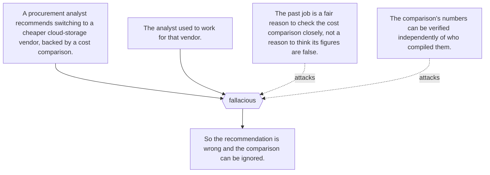

## Ad populum (`ct:ad-populum`)

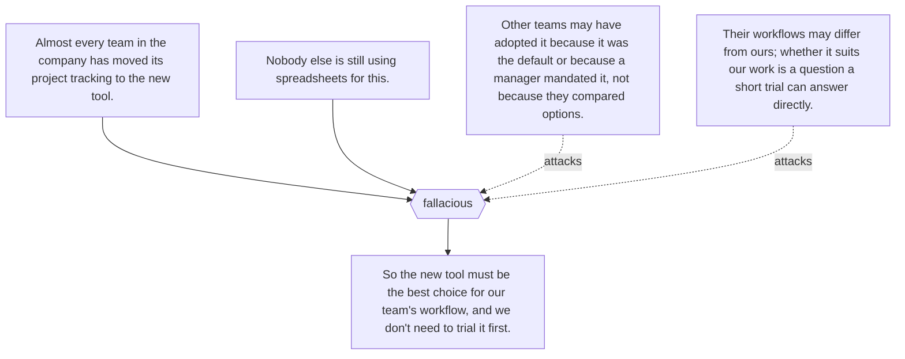

## Ad verecundiam (`ct:ad-verecundiam`)

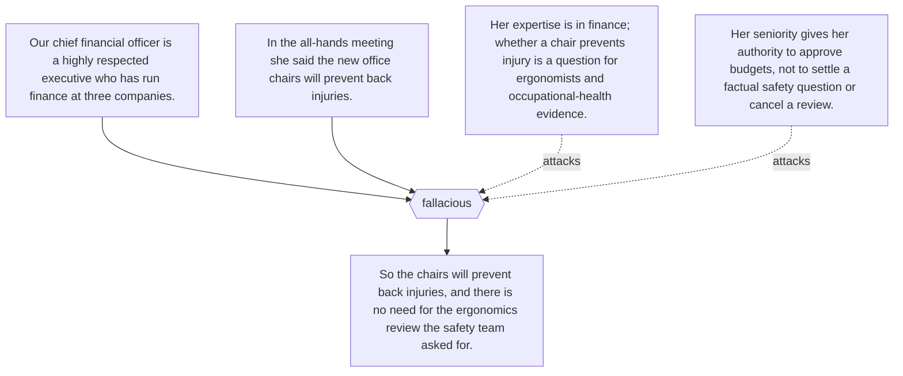

## Affirmative conclusion from a negative premise (`ct:affirmative-conclusion-from-a-negative-premise`)

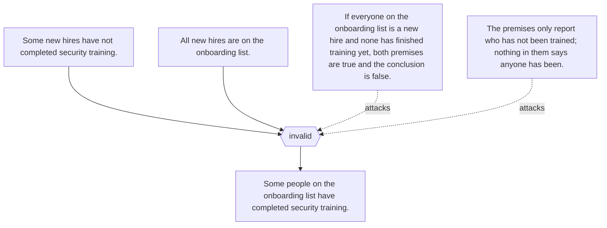

## Affirming a disjunct (`ct:affirming-a-disjunct`)

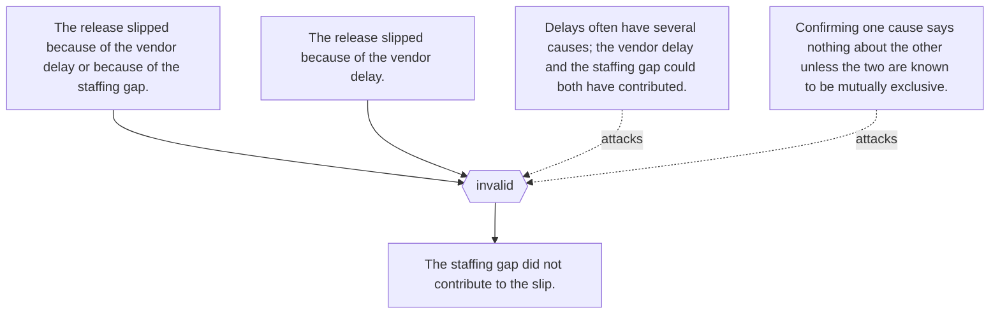

## Affirming the consequent (`ct:affirming-the-consequent`)

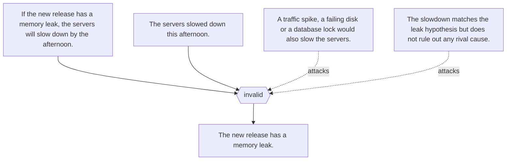

## Amphiboly (`ct:amphiboly`)

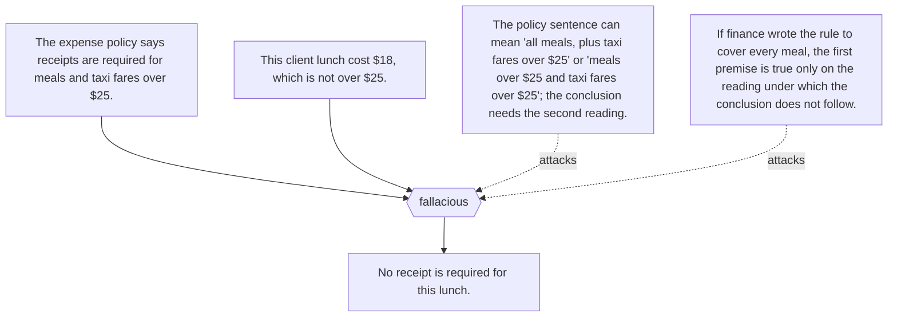

## Argument from analogy (`ct:argument-from-analogy`)

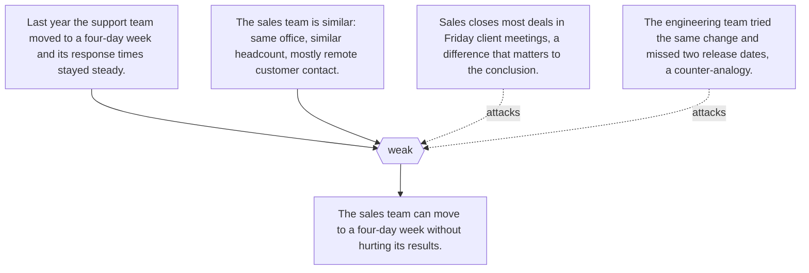

## Argument from consequences (`ct:argument-from-consequences`)

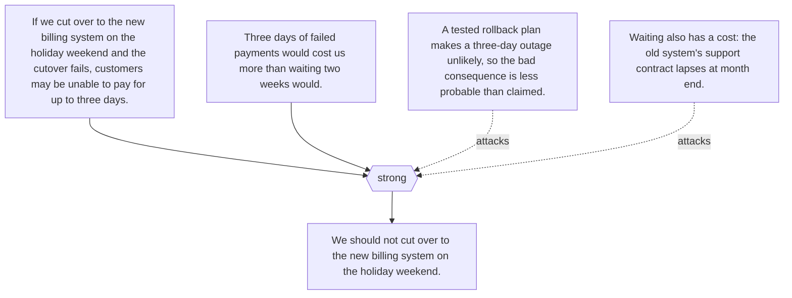

## Argument from expert opinion (`ct:argument-from-expert-opinion`)

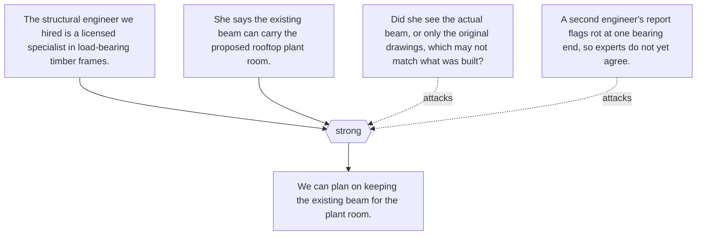

## Argument from fallacy (`ct:argument-from-fallacy`)

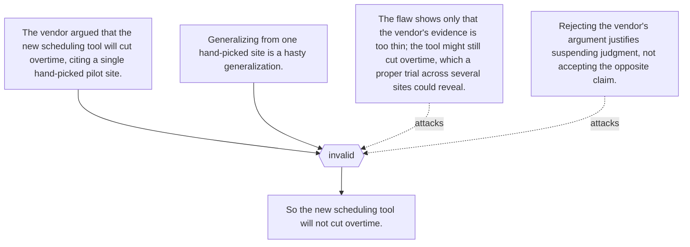

## Argument from ignorance (`ct:argument-from-ignorance`)

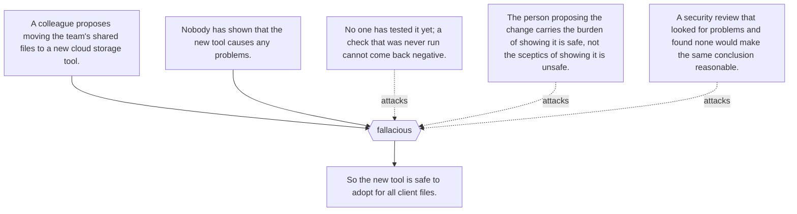

## Argumentation schemes (`ct:argumentation-schemes`)

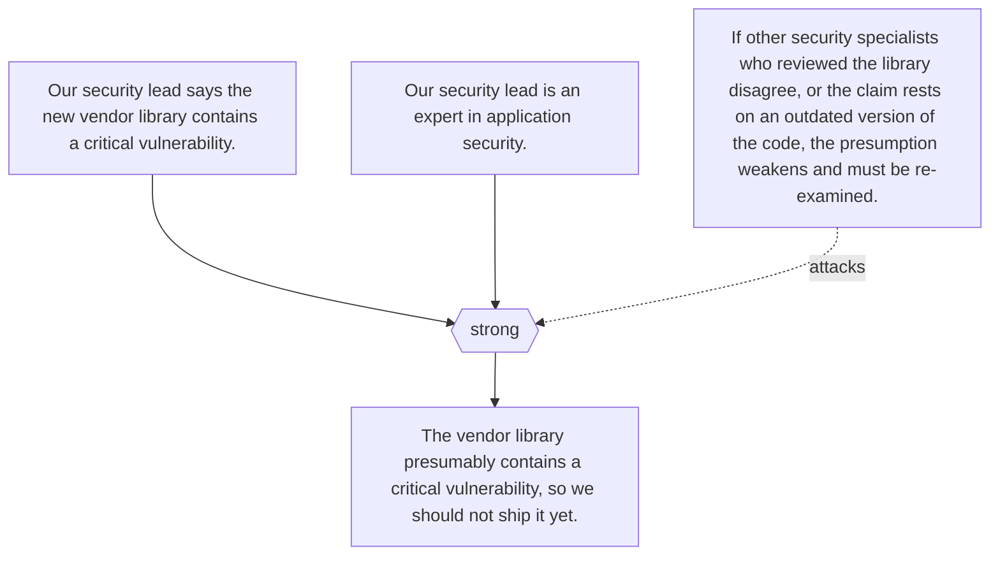

## Base-rate neglect (`ct:base-rate-neglect`)

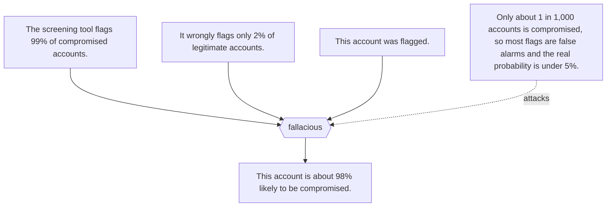

## Bayesian reasoning (`ct:bayesian-reasoning`)

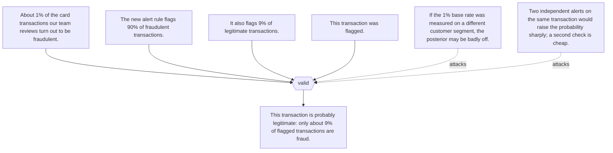

## Begging the question (`ct:begging-the-question`)

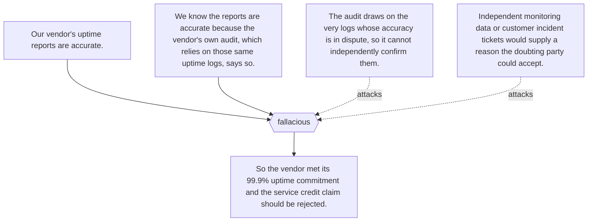

## Categorical syllogism (`ct:categorical-syllogism`)

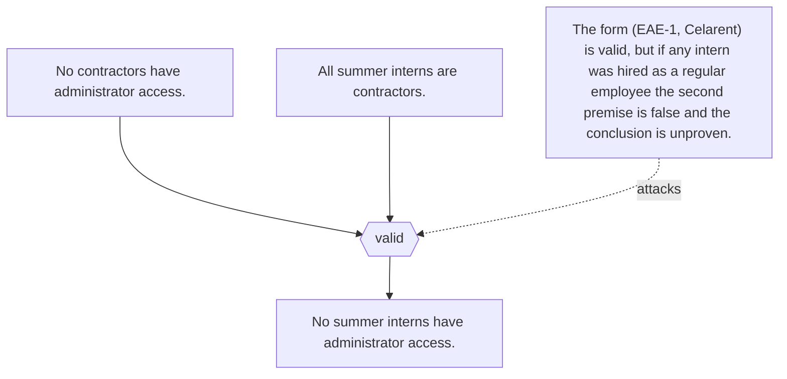

## Cogency (`ct:cogency`)

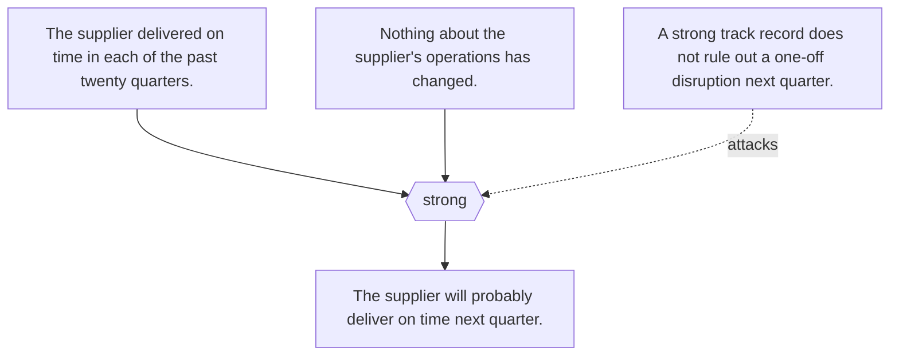

## Commutation of conditionals (`ct:commutation-of-conditionals`)

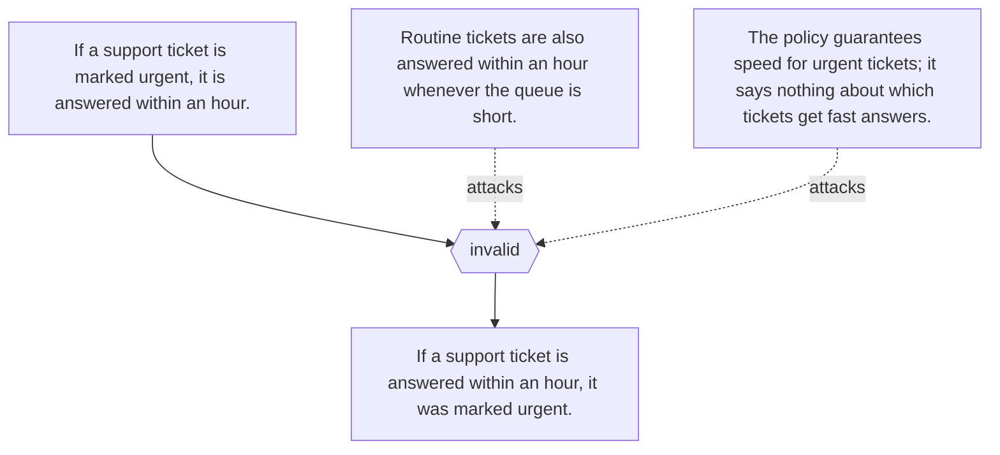

## Conductive argument (`ct:conductive-argument`)

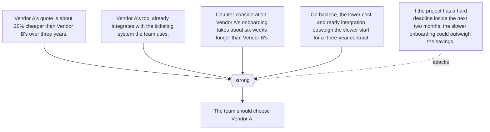

## Conjunction fallacy (`ct:conjunction-fallacy`)

```mermaid
flowchart TD
  p1["Our key vendor has thin margins and relies on a single overseas parts supplier."] --> ra{{"fallacious"}}
  p2["A story in which that supplier fails and the vendor then goes bankrupt fits these facts very well."] --> ra{{"fallacious"}}
  ra --> c["The vendor is more likely to go bankrupt because its supplier fails than to go bankrupt at all, so we should budget for the first risk and not the second."]
  o1["Every supplier-driven bankruptcy is also a bankruptcy, so 'bankrupt for any reason' must be at least as likely as 'supplier fails and vendor goes bankrupt'."] -. attacks .-> ra
```

## Deductive reasoning (`ct:deductive-reasoning`)

```mermaid
flowchart TD
  p1["Every purchase over the department's approval limit needs sign-off from finance."] --> ra{{"valid"}}
  p2["This laptop order is over the department's approval limit."] --> ra{{"valid"}}
  ra --> c["This laptop order needs sign-off from finance."]
  o1["The conclusion is only as reliable as the premises: if the limit was raised last quarter, the argument stays valid but becomes unsound."] -. attacks .-> ra
```

## Defeasible reasoning (`ct:defeasible-reasoning`)

```mermaid
flowchart TD
  p1["The office thermostat reads 21 degrees."] --> ra{{"strong"}}
  p2["Thermostat readings are normally accurate."] --> ra{{"strong"}}
  ra --> c["The office is about 21 degrees."]
  o1["Facilities reports that this thermostat's sensor has been faulty all week (undercutting defeater)."] -. attacks .-> ra
  o2["A freshly calibrated thermometer on the same desk reads 26 degrees (rebutting defeater)."] -. attacks .-> ra
```

## Denying a conjunct (`ct:denying-a-conjunct`)

```mermaid
flowchart TD
  p1["The outage was not caused by both the database migration and the network change."] --> ra{{"invalid"}}
  p2["The outage was not caused by the database migration."] --> ra{{"invalid"}}
  ra --> c["The outage was caused by the network change."]
  o1["Neither change may be responsible; a third cause, such as an expired certificate, fits both premises."] -. attacks .-> ra
  o2["The premises only rule out the two changes acting together; they never say one of them must be the cause."] -. attacks .-> ra
```

## Denying the antecedent (`ct:denying-the-antecedent`)

```mermaid
flowchart TD
  p1["If the big client renews by Friday, the team will hit its quarterly target."] --> ra{{"invalid"}}
  p2["The big client did not renew by Friday."] --> ra{{"invalid"}}
  ra --> c["The team will not hit its quarterly target."]
  o1["Several smaller deals closing this month could make up the target without the renewal."] -. attacks .-> ra
  o2["The conditional names one sufficient route to the target, not the only one."] -. attacks .-> ra
```

## Disjunctive syllogism (`ct:disjunctive-syllogism`)

```mermaid
flowchart TD
  p1["The shared printer is failing because of the network connection or because of the print driver."] --> ra{{"valid"}}
  p2["Network diagnostics show the printer's connection is working."] --> ra{{"valid"}}
  ra --> c["The printer is failing because of the print driver."]
  o1["The form is valid, but the first premise may leave out live options such as a paper jam or a hardware fault, which would make the argument unsound."] -. attacks .-> ra
  o2["If the diagnostics are unreliable, the second premise is doubtful and the elimination does not go through."] -. attacks .-> ra
```

## Equivocation (`ct:equivocation`)

```mermaid
flowchart TD
  p1["The analyst role requires experience with the company's reporting database."] --> ra{{"fallacious"}}
  p2["This candidate has experience with the reporting database: they completed a one-hour vendor tutorial on it."] --> ra{{"fallacious"}}
  ra --> c["This candidate meets the analyst role's experience requirement."]
  o1["In the job requirement, 'experience' means sustained hands-on work on real reports; in the second premise it means any exposure at all."] -. attacks .-> ra
  o2["Read with one sense throughout, either the second premise is false or the conclusion no longer follows."] -. attacks .-> ra
```

## Exclusive premises (`ct:exclusive-premises`)

```mermaid
flowchart TD
  p1["No members of the security team can approve expenses."] --> ra{{"invalid"}}
  p2["No interns are members of the security team."] --> ra{{"invalid"}}
  ra --> c["No interns can approve expenses."]
  o1["The premises only say who is outside the security team; an intern could still approve expenses through a project budget role."] -. attacks .-> ra
  o2["Both premises would stay true even if every intern could approve expenses, so they cannot rule it out."] -. attacks .-> ra
```

## Existential fallacy (`ct:existential-fallacy`)

```mermaid
flowchart TD
  p1["All employees who beat their quota this quarter will get a bonus."] --> ra{{"invalid"}}
  p2["All employees who get a bonus will be named in the company newsletter."] --> ra{{"invalid"}}
  ra --> c["Some employees who beat their quota this quarter will be named in the newsletter."]
  o1["Both premises are rules about whoever beats quota; neither says that anyone did."] -. attacks .-> ra
  o2["If no one beat quota this quarter, both premises are true and the conclusion is false."] -. attacks .-> ra
  o3["Adding the premise that at least one employee beat quota makes the argument valid."] -. attacks .-> ra
```

## Exists-forall to forall-exists inference (`ct:exists-forall-to-forall-exists-inference`)

```mermaid
flowchart TD
  p1["There is one senior engineer who reviewed every pull request merged this sprint."] --> ra{{"valid"}}
  ra --> c["Every pull request merged this sprint was reviewed by some senior engineer."]
  o1["The form is valid, but the premise may be false; check the review log before relying on it."] -. attacks .-> ra
  o2["The conclusion is weaker than the premise, so it cannot be used to argue back to a single reviewer."] -. attacks .-> ra
```

## Fallacies of relevance (`ct:fallacies-of-relevance`)

```mermaid
flowchart TD
  p1["The proposal to move the team to a four-day sprint cycle came from the newest analyst."] --> ra{{"fallacious"}}
  p2["She has been with the company for only three months."] --> ra{{"fallacious"}}
  ra --> c["So the four-day sprint proposal will not work for us."]
  o1["How long the proposer has worked here does not bear on whether shorter sprints would improve delivery; the evidence for the plan is never examined."] -. attacks .-> ra
  o2["Relevant premises would concern cycle times, review load or the results of a trial run."] -. attacks .-> ra
```

## Fallacy of accident (`ct:fallacy-of-accident`)

```mermaid
flowchart TD
  p1["Company policy says all expense claims must include an itemised paper receipt."] --> ra{{"fallacious"}}
  p2["The engineer's taxi in the foreign city was paid in cash, and the driver issued no receipt."] --> ra{{"fallacious"}}
  ra --> c["So the engineer's taxi fare cannot be reimbursed."]
  o1["The receipt rule exists to prevent fraud and was written for normal purchases where receipts are available; it did not anticipate cases where no receipt can be obtained."] -. attacks .-> ra
  o2["Policies of this kind usually allow a signed statement or card record in exceptional cases, so treating the rule as absolute ignores its implicit qualifications."] -. attacks .-> ra
```

## Fallacy of ambiguity (`ct:fallacy-of-ambiguity`)

```mermaid
flowchart TD
  p1["The staff handbook lets employees take a reasonable amount of unpaid leave."] --> ra{{"fallacious"}}
  p2["After a six-month product launch, it is entirely reasonable to want a month off."] --> ra{{"fallacious"}}
  ra --> c["So the handbook entitles me to a month of unpaid leave."]
  o1["In the handbook, 'reasonable' means within limits the employer judges workable; in the second premise it means understandable or justified from the employee's side."] -. attacks .-> ra
  o2["Fix either sense throughout and one premise fails or the conclusion no longer follows."] -. attacks .-> ra
```

## Fallacy of composition (`ct:fallacy-of-composition`)

```mermaid
flowchart TD
  p1["Each of the five engineers moved into the new platform team was the top performer in their previous team."] --> ra{{"fallacious"}}
  p2["A team made up entirely of top performers has the qualities of a top-performing team."] --> ra{{"fallacious"}}
  ra --> c["The new platform team will be the company's top-performing team."]
  o1["Team performance depends on coordination, shared ownership and role coverage, which individual ratings do not measure."] -. attacks .-> ra
  o2["Five people used to leading may compete for the same work while leaving support roles such as testing and documentation uncovered."] -. attacks .-> ra
```

## Fallacy of division (`ct:fallacy-of-division`)

```mermaid
flowchart TD
  p1["The regional sales division beat its annual revenue target by 12 percent."] --> ra{{"fallacious"}}
  p2["Each sales representative works in the regional sales division."] --> ra{{"fallacious"}}
  ra --> c["Each sales representative in the division beat their individual revenue target."]
  o1["The division total can exceed target because two or three large accounts closed, while several representatives still fell short."] -. attacks .-> ra
  o2["Beating a division target is a fact about summed revenue; it says nothing about how that sum was spread across people."] -. attacks .-> ra
```

## Fallacy of four terms (`ct:fallacy-of-four-terms`)

```mermaid
flowchart TD
  p1["All tools that have passed the security review are approved for production use."] --> ra{{"invalid"}}
  p2["All of the vendor's plugins have passed a security review."] --> ra{{"invalid"}}
  ra --> c["All of the vendor's plugins are approved for production use."]
  o1["The first premise means the company's own formal review; the second may mean the vendor's internal check."] -. attacks .-> ra
  o2["With two different reviews in play, the argument has four terms, and nothing links the plugins to approval."] -. attacks .-> ra
```

## False dilemma (`ct:false-dilemma`)

```mermaid
flowchart TD
  p1["Either we hire two more support agents this quarter or our customer satisfaction scores will collapse."] --> ra{{"fallacious"}}
  p2["We cannot afford two more agents this quarter."] --> ra{{"fallacious"}}
  ra --> c["So our customer satisfaction scores will collapse."]
  o1["The team could add a self-service help page, reroute simple tickets, or hire one part-time agent; the either-or premise omits these."] -. attacks .-> ra
  o2["Satisfaction might be protected by fixing the product issues that generate most tickets, which neither option addresses."] -. attacks .-> ra
```

## Gambler's fallacy (`ct:gamblers-fallacy`)

```mermaid
flowchart TD
  p1["The quality team's random spot-check has passed the last seven shipments in a row."] --> ra{{"fallacious"}}
  p2["Inspections fail about one time in ten over the long run, and each shipment is checked independently."] --> ra{{"fallacious"}}
  ra --> c["The next shipment is now very likely to fail, so we should flag it before it is even inspected."]
  o1["If each check is independent, the chance the next one fails is still about one in ten; seven passes do not create a debt that the next shipment must repay."] -. attacks .-> ra
```

## Gish gallop (`ct:gish-gallop`)

```mermaid
flowchart TD
  p1["In a ten-minute vendor review, the incumbent supplier's account manager lists fourteen alleged problems with a rival's product, from outages to licensing traps to security gaps."] --> ra{{"fallacious"}}
  p2["The procurement analyst has three minutes to reply and shows that two of the claims are out of date."] --> ra{{"fallacious"}}
  p3["The account manager then points out that the other twelve problems were never answered."] --> ra{{"fallacious"}}
  ra --> c["So the rival's product is unsafe and we should renew the current contract."]
  o1["Twelve claims going unanswered in three minutes shows the format was too short, not that the claims are true."] -. attacks .-> ra
  o2["Two of the claims the analyst did check turned out to be false, which counts against trusting the rest without verification."] -. attacks .-> ra
```

## Hasty generalization (`ct:hasty-generalization`)

```mermaid
flowchart TD
  p1["At the trade show, three visitors to our booth said they wanted a dark mode in the app."] --> ra{{"fallacious"}}
  p2["Two support tickets last week also asked for a dark mode."] --> ra{{"fallacious"}}
  ra --> c["So most of our customers want dark mode, and it should be next quarter's top priority."]
  o1["Five requests out of several thousand active customers is a tiny sample."] -. attacks .-> ra
  o2["Trade-show visitors and people who file tickets are self-selected and may not resemble the typical customer."] -. attacks .-> ra
  o3["Nobody checked the feature-request backlog or usage survey for competing priorities."] -. attacks .-> ra
```

## Hot-hand fallacy (`ct:hot-hand-fallacy`)

```mermaid
flowchart TD
  p1["A recruiter has filled her last four open roles within a week each."] --> ra{{"fallacious"}}
  p2["Her long-run record is that about half of her roles fill within a week."] --> ra{{"fallacious"}}
  ra --> c["She is on a hot streak, so the next hard-to-fill role is very likely to close within a week if we give it to her."]
  o1["A run of four quick fills is common for someone with a 50% rate over a year of roles; the streak alone barely moves the estimate for the next role."] -. attacks .-> ra
  o2["If the recent roles were easier or in a hotter market, the streak reflects the cases, not a change in her skill."] -. attacks .-> ra
```

## Ignoratio elenchi (`ct:ignoratio-elenchi`)

```mermaid
flowchart TD
  p1["The question on the table is whether the new expense tool should replace the old one next quarter."] --> ra{{"fallacious"}}
  p2["The finance lead shows that the new tool's dashboards are more attractive and that its vendor has won design awards."] --> ra{{"fallacious"}}
  ra --> c["So we should switch to the new expense tool next quarter."]
  o1["The evidence supports 'the new tool looks better', not 'switching next quarter is worth the cost and disruption'."] -. attacks .-> ra
  o2["Nothing in the argument addresses migration effort, accuracy of reimbursements or staff training, which the decision turns on."] -. attacks .-> ra
```

## Illicit contraposition (`ct:illicit-contraposition`)

```mermaid
flowchart TD
  p1["No contractors are on the company payroll."] --> ra{{"invalid"}}
  ra --> c["So no one who is off the payroll is a non-contractor; everyone off the payroll is a contractor."]
  o1["The premise only separates contractors from payroll staff; it says nothing about people who are neither, such as agency temps, interns paid by a university or visiting auditors."] -. attacks .-> ra
  o2["One agency temp who is off the payroll and is not a contractor keeps the premise true and makes the conclusion false."] -. attacks .-> ra
```

## Illicit conversion (`ct:illicit-conversion`)

```mermaid
flowchart TD
  p1["All of our certified suppliers passed the safety audit."] --> ra{{"invalid"}}
  ra --> c["So every supplier that passed the safety audit is one of our certified suppliers."]
  o1["The premise puts certified suppliers inside the group that passed; it says nothing about suppliers that passed but never applied for certification."] -. attacks .-> ra
  o2["An uncertified local supplier could pass the same audit while the premise stays true and the conclusion is false."] -. attacks .-> ra
```

## Illicit major (`ct:illicit-major`)

```mermaid
flowchart TD
  p1["All senior engineers have production access."] --> ra{{"invalid"}}
  p2["No contractors are senior engineers."] --> ra{{"invalid"}}
  ra --> c["No contractors have production access."]
  o1["The first premise says senior engineers are among those with access, not that they are the only ones."] -. attacks .-> ra
  o2["A contractor on the on-call rota could have been granted access through another route."] -. attacks .-> ra
```

## Illicit minor (`ct:illicit-minor`)

```mermaid
flowchart TD
  p1["All members of the incident-response team are certified in first aid."] --> ra{{"invalid"}}
  p2["All members of the incident-response team are full-time staff."] --> ra{{"invalid"}}
  ra --> c["All full-time staff are certified in first aid."]
  o1["The second premise places the team inside the full-time staff; it says nothing about full-time staff who are not on the team."] -. attacks .-> ra
  o2["A full-time accountant who never joined the team could lack the certificate while both premises stay true."] -. attacks .-> ra
```

## Illicit subalternation (`ct:illicit-subalternation`)

```mermaid
flowchart TD
  p1["Some of the laptops in the returns bin have cracked screens."] --> ra{{"invalid"}}
  ra --> c["So all of the laptops in the returns bin have cracked screens."]
  o1["Subalternation runs from the universal to the particular; a true particular leaves the universal undetermined."] -. attacks .-> ra
  o2["The bin could hold one laptop with a cracked screen and nine returned for battery faults, which keeps the premise true and makes the conclusion false."] -. attacks .-> ra
```

## Improper transposition (`ct:improper-transposition`)

```mermaid
flowchart TD
  p1["If an expense claim is over 500 dollars, it needs a director's sign-off."] --> ra{{"invalid"}}
  ra --> c["If an expense claim is not over 500 dollars, it does not need a director's sign-off."]
  o1["The policy may also require a director's sign-off for any foreign travel claim, whatever its amount."] -. attacks .-> ra
  o2["The rule names one condition that triggers sign-off; it does not say that it is the only one."] -. attacks .-> ra
```

## Inductive reasoning (`ct:inductive-reasoning`)

```mermaid
flowchart TD
  p1["In each of the last twelve quarterly releases, the mobile app saw a spike in support tickets during the first week."] --> ra{{"strong"}}
  p2["Next week's release follows the same process and ships to the same user base."] --> ra{{"strong"}}
  ra --> c["Next week's release will probably also cause a first-week spike in support tickets."]
  o1["If this release changes the process (for example, a staged rollout), the past pattern may no longer project."] -. attacks .-> ra
  o2["Twelve releases is a modest sample; a coincidence of scheduling could explain the pattern."] -. attacks .-> ra
```

## Inference to the best explanation (`ct:inference-to-the-best-explanation`)

```mermaid
flowchart TD
  p1["Since Tuesday's deploy, the checkout service has been timing out, but only for requests that hit the new discount code path."] --> ra{{"strong"}}
  p2["A bad database index added in that deploy would explain both the timing and why only the discount path is slow."] --> ra{{"strong"}}
  p3["The rival explanations (a network fault, a traffic spike, a third-party outage) would slow every path, and monitoring shows normal traffic and healthy vendors."] --> ra{{"strong"}}
  p4["The index explanation is a good explanation in its own right: it is specific and testable."] --> ra{{"strong"}}
  ra --> c["The new index is probably causing the timeouts, so it is the hypothesis to act on and test first."]
  o1["The rival list may be a bad lot: an untried cause, such as a changed cache setting in the same deploy, could explain the pattern better."] -. attacks .-> ra
  o2["Rolling back the index and watching the timeouts is a test the inference recommends, not one it replaces."] -. attacks .-> ra
```

## Confusion of the inverse (`ct:inverse-fallacy`)

```mermaid
flowchart TD
  p1["Our security vendor reports that 90% of phishing emails trigger its 'suspicious link' alert."] --> ra{{"fallacious"}}
  p2["This email from a supplier triggered the alert."] --> ra{{"fallacious"}}
  ra --> c["So there is a 90% chance this supplier email is phishing."]
  o1["The 90% figure is P(alert | phishing), not P(phishing | alert); the answer also depends on how rare phishing is and how often clean mail trips the alert."] -. attacks .-> ra
  o2["If 1 in 100 emails is phishing and 5% of clean emails trigger the alert, then of 1,000 emails about 9 phishing and about 50 clean ones are flagged, so only about 15% of alerts are phishing."] -. attacks .-> ra
```

## Masked-man fallacy (`ct:masked-man-fallacy`)

```mermaid
flowchart TD
  p1["The anonymous reviewer of our grant proposal is the head of the research office."] --> ra{{"invalid"}}
  p2["The project lead believes the anonymous reviewer was unfair to us."] --> ra{{"invalid"}}
  ra --> c["The project lead believes the head of the research office was unfair to us."]
  o1["The project lead does not know who the reviewer is, so their belief is about 'the reviewer', not about the head of the office."] -. attacks .-> ra
  o2["The lead may sincerely say the head of the research office has always treated the team fairly; both reports can be true at once."] -. attacks .-> ra
```

## Modal scope fallacy (`ct:modal-scope-fallacy`)

```mermaid
flowchart TD
  p1["If the release has passed every regression test, it cannot contain a regression."] --> ra{{"invalid"}}
  p2["The release has passed every regression test."] --> ra{{"invalid"}}
  ra --> c["It is impossible for this release to contain a regression."]
  o1["What is impossible is passing every test that would catch a regression while still containing that regression; the 'cannot' governs the whole conditional."] -. attacks .-> ra
  o2["The valid conclusion is only that the release contains no regression the tests check for, not that it could not have contained one."] -. attacks .-> ra
```

## Modus ponens (`ct:modus-ponens`)

```mermaid
flowchart TD
  p1["If a support ticket is marked urgent, it must get a first response within one hour."] --> ra{{"valid"}}
  p2["This support ticket is marked urgent."] --> ra{{"valid"}}
  ra --> c["This support ticket must get a first response within one hour."]
  o1["The form is valid, but the conclusion is only as good as the policy premise: if urgent tickets also require an on-call engineer to be reachable, the stated conditional is incomplete."] -. attacks .-> ra
```

## Modus tollens (`ct:modus-tollens`)

```mermaid
flowchart TD
  p1["If the nightly backup job ran successfully, there is a backup file stamped with today's date."] --> ra{{"valid"}}
  p2["There is no backup file stamped with today's date."] --> ra{{"valid"}}
  ra --> c["The nightly backup job did not run successfully."]
  o1["The form is valid, but the conditional premise may be false: the job could have succeeded while writing to a different folder or stamping the file in another time zone."] -. attacks .-> ra
```

## Motte-and-bailey (`ct:motte-and-bailey`)

```mermaid
flowchart TD
  p1["Bailey (stated in the planning meeting): The new dashboard proves the onboarding redesign doubled customer retention, so we should roll it out to every region now."] --> ra{{"fallacious"}}
  p2["Motte (stated when a colleague asks for the analysis): All I am saying is that the dashboard shows retention went up after the redesign."] --> ra{{"fallacious"}}
  p3["Nobody disputes that retention went up after the redesign."] --> ra{{"fallacious"}}
  ra --> c["So the full regional rollout is justified."]
  o1["Retention rising after the redesign does not show that the redesign caused the rise, still less that it doubled retention."] -. attacks .-> ra
  o2["Conceding the motte leaves the bailey undefended; the rollout needed the bold causal claim, which was never argued for."] -. attacks .-> ra
```

## No true Scotsman (`ct:no-true-scotsman`)

```mermaid
flowchart TD
  p1["No experienced engineer on our team would ever push code without running the tests."] --> ra{{"fallacious"}}
  p2["A colleague with ten years on the team and pushed untested code last week."] --> ra{{"fallacious"}}
  p3["A truly experienced engineer would never have done that."] --> ra{{"fallacious"}}
  ra --> c["So that colleague is not really an experienced engineer, and the original claim stands."]
  o1["Experience was first measured by years on the team; it is now being measured by never skipping tests, which makes the claim true by definition."] -. attacks .-> ra
  o2["The counterexample should lead to revising the generalization (most experienced engineers run tests), not to reclassifying the colleague."] -. attacks .-> ra
```

## Non sequitur (`ct:non-sequitur`)

```mermaid
flowchart TD
  p1["The new CRM vendor has the most polished website of the three we reviewed."] --> ra{{"invalid"}}
  p2["Their sales representative answered every email within an hour."] --> ra{{"invalid"}}
  ra --> c["So their platform will keep our customer data secure."]
  o1["Marketing polish and quick sales replies say nothing about encryption, access control or breach history; a security review or third-party audit report is what bears on the conclusion."] -. attacks .-> ra
  o2["All three vendors could have responsive sales staff and still differ sharply in how they protect data."] -. attacks .-> ra
```

## Obversion (`ct:obversion`)

```mermaid
flowchart TD
  p1["All parcels in today's outbound batch have been weighed."] --> ra{{"valid"}}
  ra --> c["No parcels in today's outbound batch are unweighed (non-weighed) parcels."]
  o1["The step holds only if 'unweighed' names everything that is not weighed; a contrary such as 'overweight' would not do."] -. attacks .-> ra
```

## Post hoc ergo propter hoc (`ct:post-hoc-ergo-propter-hoc`)

```mermaid
flowchart TD
  p1["The office switched to a new IT help-desk ticketing tool in March."] --> ra{{"fallacious"}}
  p2["Complaints about slow IT support fell sharply in April."] --> ra{{"fallacious"}}
  ra --> c["So the new ticketing tool reduced complaints."]
  o1["February had an unusual spike of outages, so complaints may simply have returned to their normal level."] -. attacks .-> ra
  o2["Two extra support staff were hired in March, which could explain the drop on its own."] -. attacks .-> ra
  o3["No comparison with teams still on the old tool, or with previous Aprils, was made."] -. attacks .-> ra
```

## Probabilistic modus tollens (`ct:probabilistic-modus-tollens`)

```mermaid
flowchart TD
  p1["If a support ticket comes from a paying customer, it very probably does not come from our single largest account."] --> ra{{"invalid"}}
  p2["This ticket comes from our single largest account."] --> ra{{"invalid"}}
  ra --> c["This ticket probably does not come from a paying customer."]
  o1["The largest account is itself a paying customer, so the conclusion is certainly false even though both premises are true."] -. attacks .-> ra
  o2["The first premise is true only because there are thousands of customers; rarity under the hypothesis says nothing about rarity under the alternatives."] -. attacks .-> ra
```

## Prosecutor's fallacy (`ct:prosecutors-fallacy`)

```mermaid
flowchart TD
  p1["The badge reader logged a card whose partial ID matches this employee's card."] --> ra{{"fallacious"}}
  p2["Only 1 in 1,000 cards in the building system would share that partial ID by chance."] --> ra{{"fallacious"}}
  ra --> c["So there is a 99.9% chance this employee entered the server room."]
  o1["With about 5,000 cards on the system, roughly five would match by chance, so without other evidence the match alone points to one of about six cardholders."] -. attacks .-> ra
  o2["The 1-in-1,000 figure is the probability of a match if the employee did not enter, not the probability the employee did not enter given the match."] -. attacks .-> ra
```

## Quantifier shift fallacy (`ct:quantifier-shift-fallacy`)

```mermaid
flowchart TD
  p1["Every project in the portfolio has someone on the finance team who can sign off its budget."] --> ra{{"invalid"}}
  ra --> c["Someone on the finance team can sign off every project's budget."]
  o1["Sign-off rights may be split by business unit, so each project has an approver but no one approves all of them."] -. attacks .-> ra
  o2["To show one person covers everything, check the approval matrix directly; the premise does not say so."] -. attacks .-> ra
```

## Red herring (`ct:red-herring`)

```mermaid
flowchart TD
  p1["The question in the review meeting is whether the release should slip a week because the payment tests are failing."] --> ra{{"fallacious"}}
  p2["The product lead replies that the competitor's app crashed for two days last month and nobody even noticed."] --> ra{{"fallacious"}}
  p3["The lead then spends the rest of the meeting on how badly the competitor is run."] --> ra{{"fallacious"}}
  ra --> c["So we should ship on schedule."]
  o1["The competitor's outage says nothing about whether our failing payment tests make this release unsafe."] -. attacks .-> ra
  o2["The original question was abandoned rather than answered; nothing in the discussion bears on the test failures."] -. attacks .-> ra
```

## Slippery slope (`ct:slippery-slope`)

```mermaid
flowchart TD
  p1["If we let the design team work from home on Fridays, the other teams will ask for the same."] --> ra{{"fallacious"}}
  p2["Once every team has Fridays at home, people will start asking for Mondays too, and soon nobody will come in at all."] --> ra{{"fallacious"}}
  p3["An empty office would destroy our collaboration and culture."] --> ra{{"fallacious"}}
  ra --> c["So we must not let the design team work from home on Fridays."]
  o1["No evidence is offered that each step makes the next one likely; requests for Fridays at home do not force management to grant Mondays."] -. attacks .-> ra
  o2["Management keeps control at every step: a written policy capping remote days is a bright line that stops the slide."] -. attacks .-> ra
  o3["The feared end state is assumed to be catastrophic without asking how other firms with hybrid schedules have fared."] -. attacks .-> ra
```

## Straw man fallacy (`ct:straw-man-fallacy`)

```mermaid
flowchart TD
  p1["A colleague proposes letting staff work from home on Fridays to cut commuting time."] --> ra{{"fallacious"}}
  p2["Running the company with nobody ever in the office would destroy collaboration and training."] --> ra{{"fallacious"}}
  ra --> c["So the work-from-home proposal should be rejected."]
  o1["The proposal covers one day a week, not abolishing the office; the refuted position is not the one put forward."] -. attacks .-> ra
  o2["Even if full remote work harmed collaboration, that says little about the effect of one remote day."] -. attacks .-> ra
```

## Suppressed evidence (`ct:suppressed-evidence`)

```mermaid
flowchart TD
  p1["The new supplier delivered our last three orders early."] --> ra{{"fallacious"}}
  p2["Their unit price is 10 percent below our current supplier's."] --> ra{{"fallacious"}}
  p3["(Unstated) Two of their five shipments this quarter failed quality inspection."] --> ra{{"fallacious"}}
  ra --> c["We should move all our orders to the new supplier."]
  o1["The stated premises are true, but the omitted inspection failures bear directly on whether switching is wise."] -. attacks .-> ra
  o2["Three early deliveries chosen from five orders say little about reliability across the whole record."] -. attacks .-> ra
```

## Syllogism (`ct:syllogism`)

```mermaid
flowchart TD
  p1["All production deployments need an approved code review."] --> ra{{"valid"}}
  p2["All database migrations are production deployments."] --> ra{{"valid"}}
  ra --> c["All database migrations need an approved code review."]
  o1["The form (Barbara) is valid, but if some migrations run outside the deployment pipeline, the second premise is false and the argument is unsound."] -. attacks .-> ra
```

## Tu quoque (`ct:tu-quoque`)

```mermaid
flowchart TD
  p1["A team lead asks everyone to log project hours by Friday so client invoices are accurate."] --> ra{{"fallacious"}}
  p2["The team lead often logs her own hours late."] --> ra{{"fallacious"}}
  ra --> c["So the Friday logging rule is pointless and the team can ignore it."]
  o1["Whether timely logging keeps invoices accurate does not depend on the team lead's own habits."] -. attacks .-> ra
  o2["Her lateness may justify asking her to explain herself or to follow the rule too, not dropping the rule."] -. attacks .-> ra
```

## Undistributed middle (`ct:undistributed-middle`)

```mermaid
flowchart TD
  p1["All of our certified suppliers use encrypted file transfer."] --> ra{{"invalid"}}
  p2["The new printing vendor uses encrypted file transfer."] --> ra{{"invalid"}}
  ra --> c["The new printing vendor is one of our certified suppliers."]
  o1["Neither premise is about everyone who uses encrypted file transfer, so the vendor may belong to a part of that group that contains no certified supplier."] -. attacks .-> ra
  o2["Plenty of uncertified firms use encrypted transfer; the shared trait does not establish membership."] -. attacks .-> ra
```

## Unwarranted contrast (`ct:unwarranted-contrast`)

```mermaid
flowchart TD
  p1["The audit report says some of our supplier invoices were paid late."] --> ra{{"invalid"}}
  ra --> c["So some of our supplier invoices were paid on time."]
  o1["If every invoice in the period was paid late, the premise is still true and the conclusion is false."] -. attacks .-> ra
  o2["The auditors may have checked only a sample and said 'some' because they could not speak for the rest."] -. attacks .-> ra
```

## Value-based practical reasoning (`ct:value-based-practical-reasoning`)

```mermaid
flowchart TD
  p1["Our team is split across three time zones, and the weekly status meeting falls at 7 a.m. or 9 p.m. for half of us."] --> ra{{"strong"}}
  p2["Replacing the meeting with a written update thread would let everyone contribute during their own working hours."] --> ra{{"strong"}}
  p3["Letting everyone contribute in working hours treats all team members fairly."] --> ra{{"strong"}}
  ra --> c["We should replace the weekly status meeting with a written update thread."]
  o1["Rotating the meeting time would also share the burden fairly while keeping live discussion (an alternative that promotes the same value)."] -. attacks .-> ra
  o2["Dropping all live contact may weaken team cohesion, a value some members rank above convenience (a side effect demoting another value)."] -. attacks .-> ra
```

