# Argument maps

Worked examples from each article's `argumentMap`, exported to RDF as AIF I-nodes (claims), RA-nodes (inferences) and CA-nodes (conflicts). Generated by `scripts/kg.py build`.

## Ad hominem (`ct:ad-hominem`)

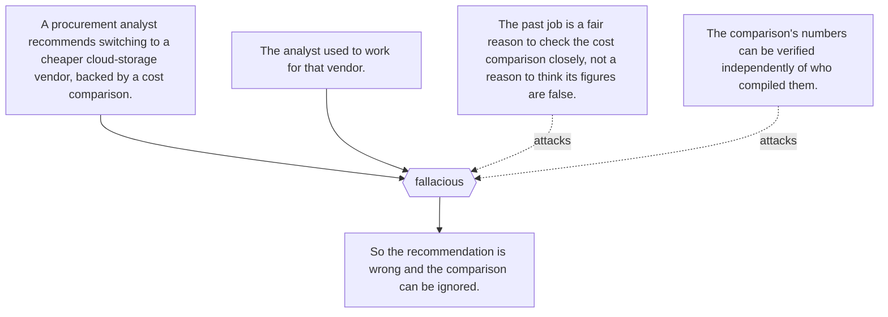

## Affirming a disjunct (`ct:affirming-a-disjunct`)

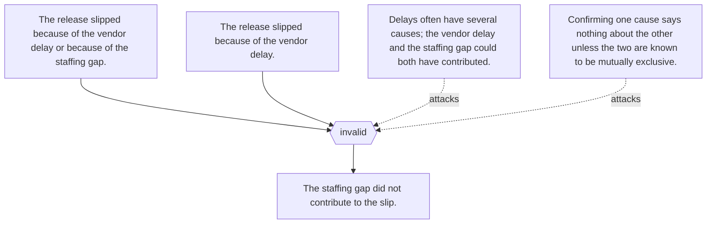

## Affirming the consequent (`ct:affirming-the-consequent`)

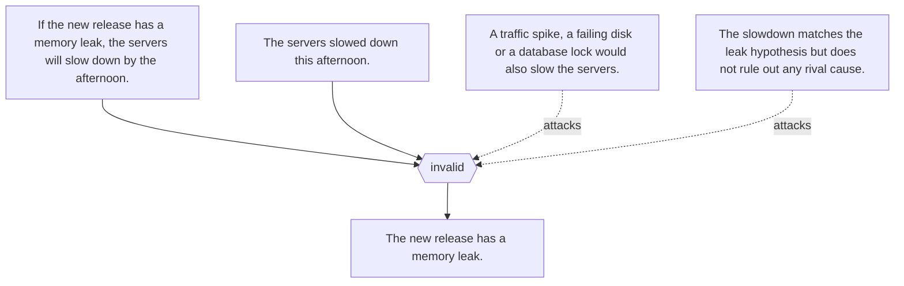

## Argument from expert opinion (`ct:argument-from-expert-opinion`)

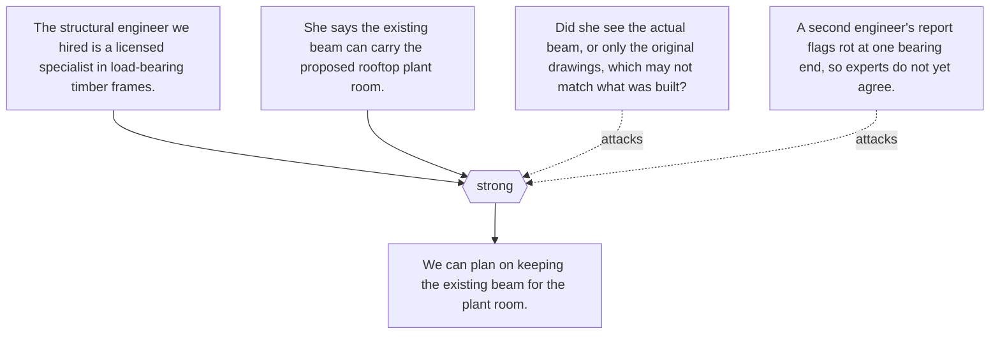

## Argumentation schemes (`ct:argumentation-schemes`)

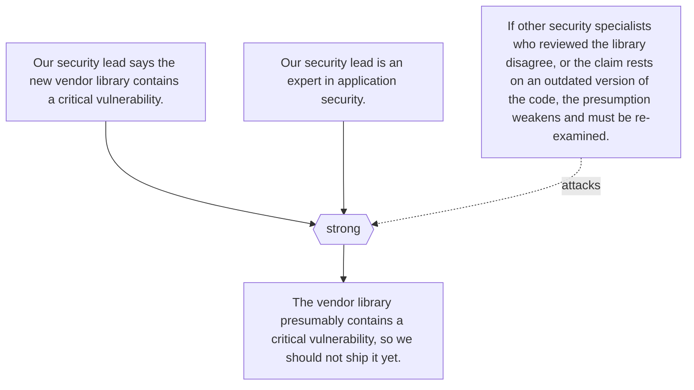

## Base-rate neglect (`ct:base-rate-neglect`)

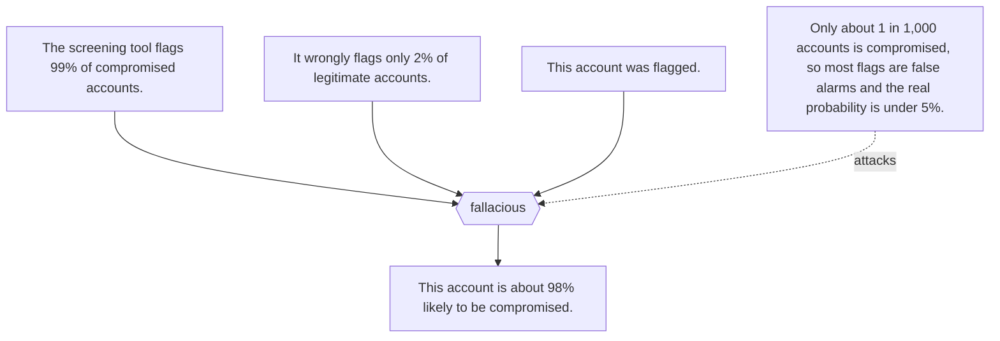

## Bayesian reasoning (`ct:bayesian-reasoning`)

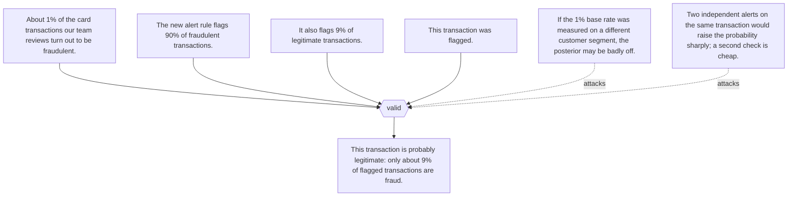

## Begging the question (`ct:begging-the-question`)

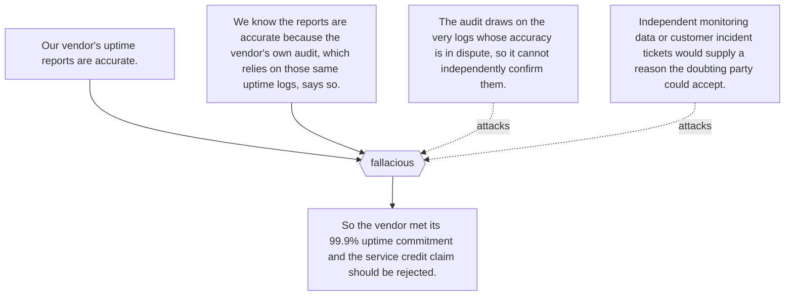

## Cogency (`ct:cogency`)

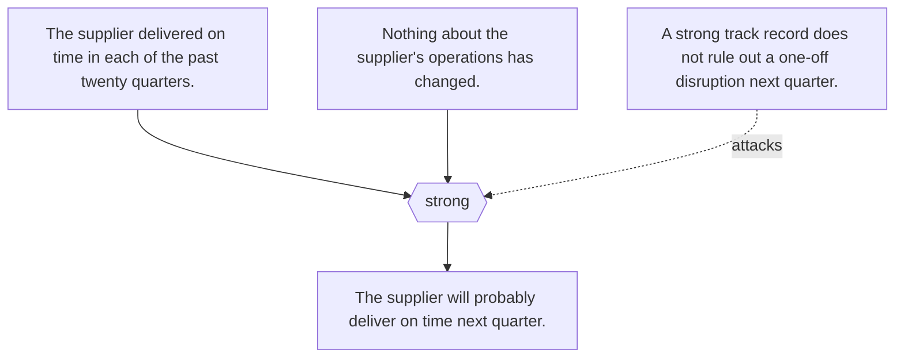

## Conjunction fallacy (`ct:conjunction-fallacy`)

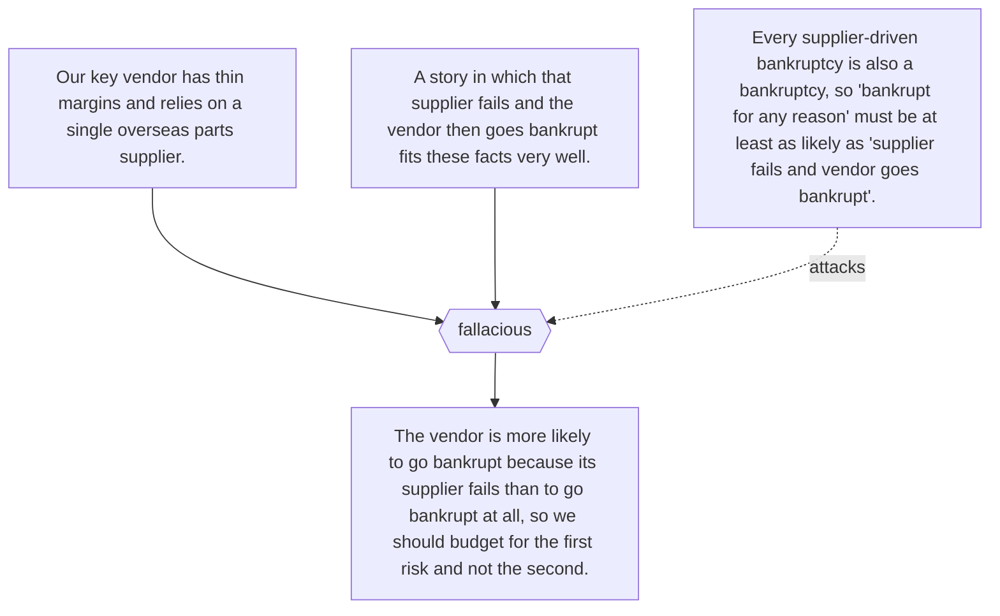

## Deductive reasoning (`ct:deductive-reasoning`)

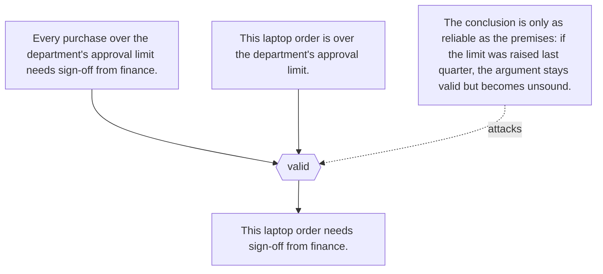

## Denying the antecedent (`ct:denying-the-antecedent`)

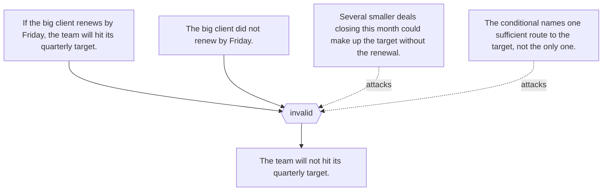

## Existential fallacy (`ct:existential-fallacy`)

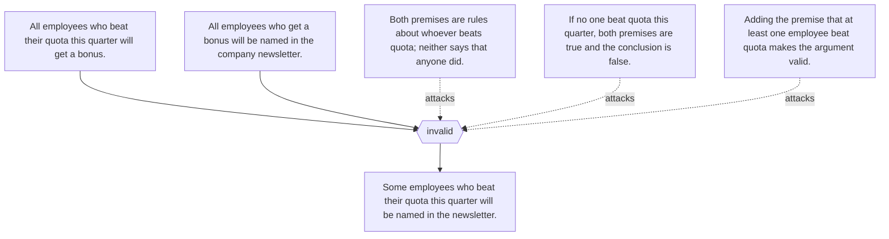

## False dilemma (`ct:false-dilemma`)

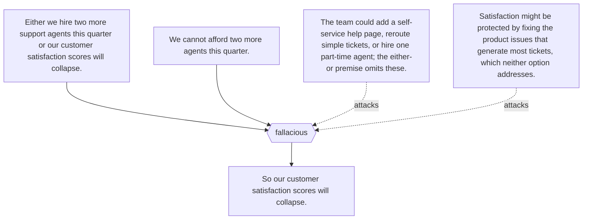

## Gambler's fallacy (`ct:gamblers-fallacy`)

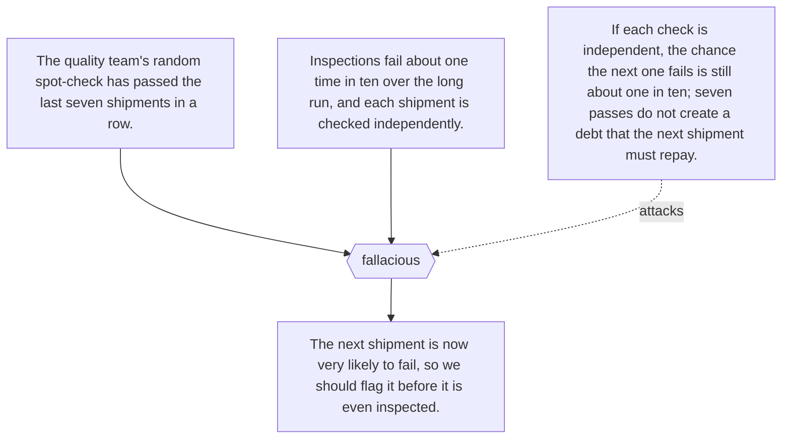

## Illicit major (`ct:illicit-major`)

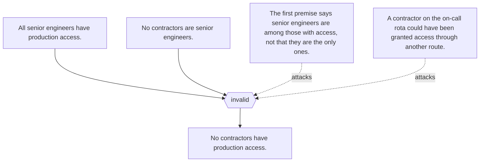

## Inductive reasoning (`ct:inductive-reasoning`)

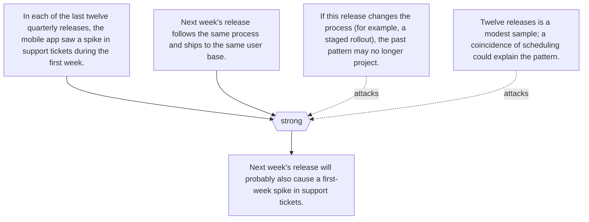

## Inference to the best explanation (`ct:inference-to-the-best-explanation`)

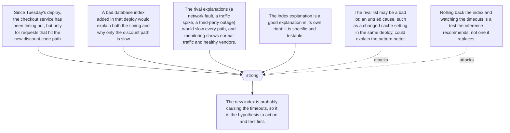

## Modus ponens (`ct:modus-ponens`)

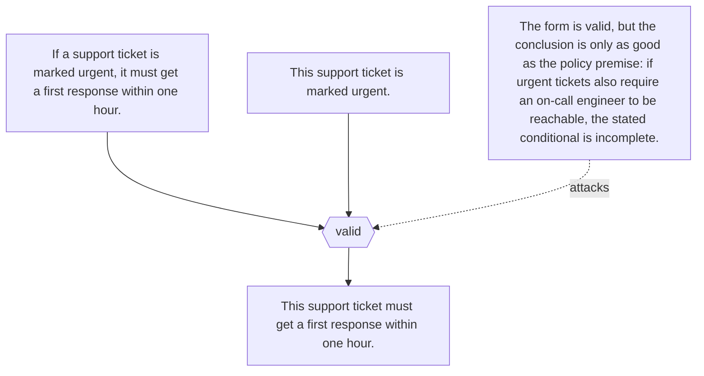

## Modus tollens (`ct:modus-tollens`)

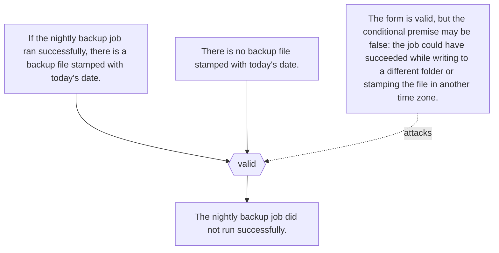

## Post hoc ergo propter hoc (`ct:post-hoc-ergo-propter-hoc`)

```mermaid
flowchart TD
  p1["The office switched to a new IT help-desk ticketing tool in March."] --> ra{{"fallacious"}}
  p2["Complaints about slow IT support fell sharply in April."] --> ra{{"fallacious"}}
  ra --> c["So the new ticketing tool reduced complaints."]
  o1["February had an unusual spike of outages, so complaints may simply have returned to their normal level."] -. attacks .-> ra
  o2["Two extra support staff were hired in March, which could explain the drop on its own."] -. attacks .-> ra
  o3["No comparison with teams still on the old tool, or with previous Aprils, was made."] -. attacks .-> ra
```

## Straw man fallacy (`ct:straw-man-fallacy`)

```mermaid
flowchart TD
  p1["A colleague proposes letting staff work from home on Fridays to cut commuting time."] --> ra{{"fallacious"}}
  p2["Running the company with nobody ever in the office would destroy collaboration and training."] --> ra{{"fallacious"}}
  ra --> c["So the work-from-home proposal should be rejected."]
  o1["The proposal covers one day a week, not abolishing the office; the refuted position is not the one put forward."] -. attacks .-> ra
  o2["Even if full remote work harmed collaboration, that says little about the effect of one remote day."] -. attacks .-> ra
```

## Suppressed evidence (`ct:suppressed-evidence`)

```mermaid
flowchart TD
  p1["The new supplier delivered our last three orders early."] --> ra{{"fallacious"}}
  p2["Their unit price is 10 percent below our current supplier's."] --> ra{{"fallacious"}}
  p3["(Unstated) Two of their five shipments this quarter failed quality inspection."] --> ra{{"fallacious"}}
  ra --> c["We should move all our orders to the new supplier."]
  o1["The stated premises are true, but the omitted inspection failures bear directly on whether switching is wise."] -. attacks .-> ra
  o2["Three early deliveries chosen from five orders say little about reliability across the whole record."] -. attacks .-> ra
```

## Syllogism (`ct:syllogism`)

```mermaid
flowchart TD
  p1["All production deployments need an approved code review."] --> ra{{"valid"}}
  p2["All database migrations are production deployments."] --> ra{{"valid"}}
  ra --> c["All database migrations need an approved code review."]
  o1["The form (Barbara) is valid, but if some migrations run outside the deployment pipeline, the second premise is false and the argument is unsound."] -. attacks .-> ra
```

## Tu quoque (`ct:tu-quoque`)

```mermaid
flowchart TD
  p1["A team lead asks everyone to log project hours by Friday so client invoices are accurate."] --> ra{{"fallacious"}}
  p2["The team lead often logs her own hours late."] --> ra{{"fallacious"}}
  ra --> c["So the Friday logging rule is pointless and the team can ignore it."]
  o1["Whether timely logging keeps invoices accurate does not depend on the team lead's own habits."] -. attacks .-> ra
  o2["Her lateness may justify asking her to explain herself or to follow the rule too, not dropping the rule."] -. attacks .-> ra
```

## Undistributed middle (`ct:undistributed-middle`)

```mermaid
flowchart TD
  p1["All of our certified suppliers use encrypted file transfer."] --> ra{{"invalid"}}
  p2["The new printing vendor uses encrypted file transfer."] --> ra{{"invalid"}}
  ra --> c["The new printing vendor is one of our certified suppliers."]
  o1["Neither premise is about everyone who uses encrypted file transfer, so the vendor may belong to a part of that group that contains no certified supplier."] -. attacks .-> ra
  o2["Plenty of uncertified firms use encrypted transfer; the shared trait does not establish membership."] -. attacks .-> ra
```

