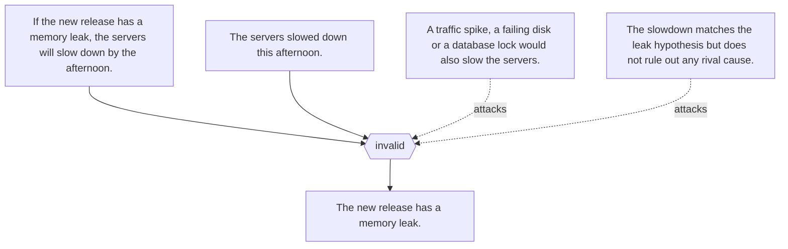

# Argument maps

Worked examples from each article's `argumentMap`, exported to RDF as AIF I-nodes (claims), RA-nodes (inferences) and CA-nodes (conflicts). Generated by `scripts/kg.py build`.

## Affirming the consequent (`ct:affirming-the-consequent`)

