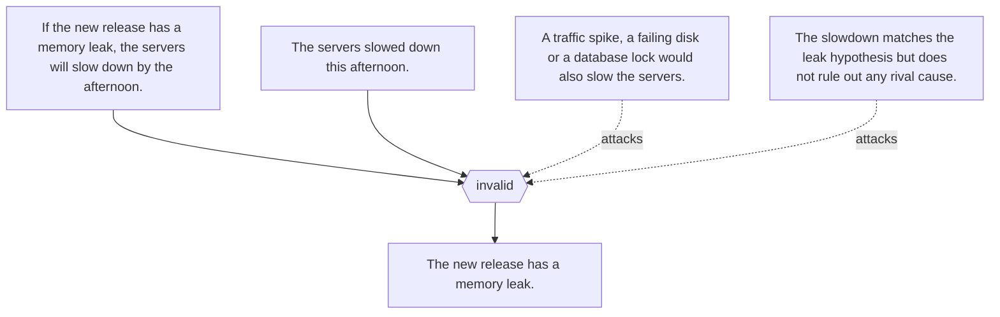
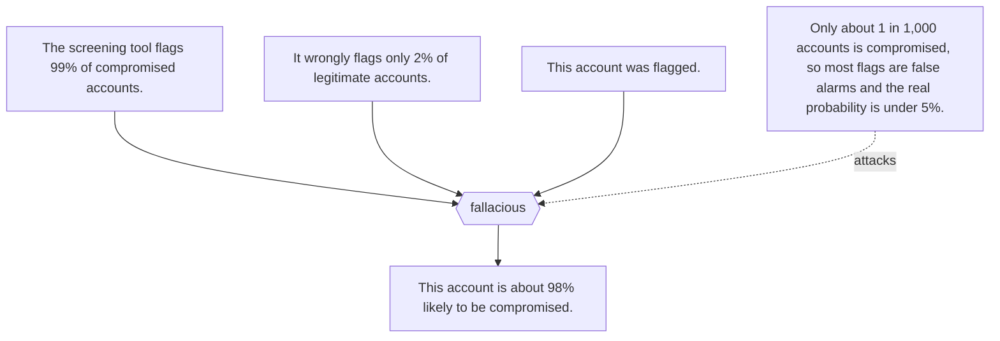
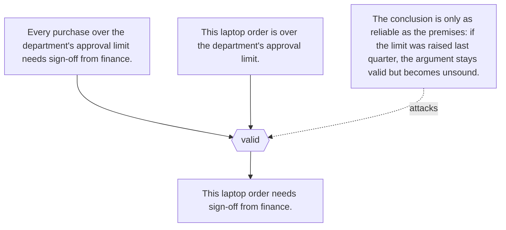
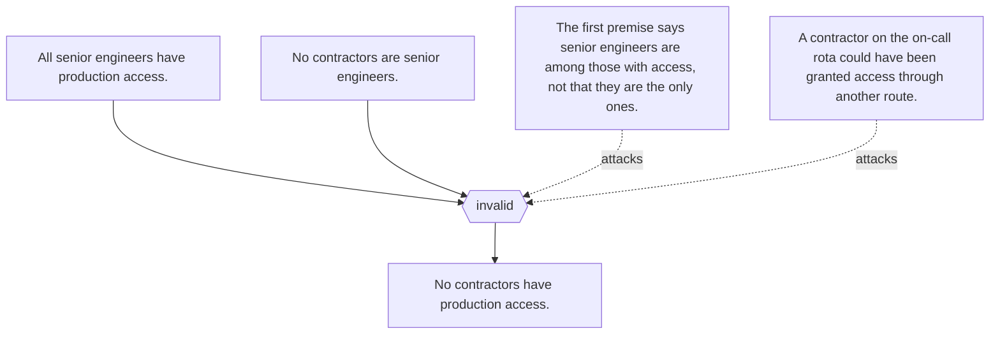
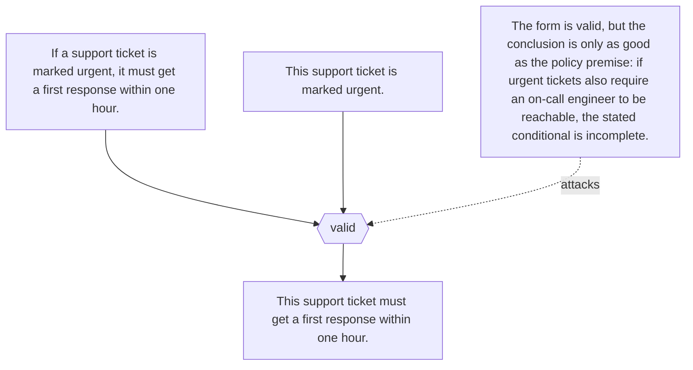
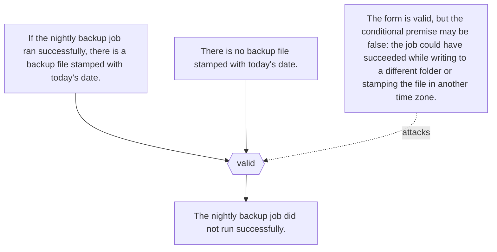
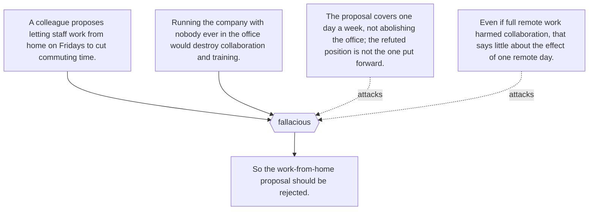
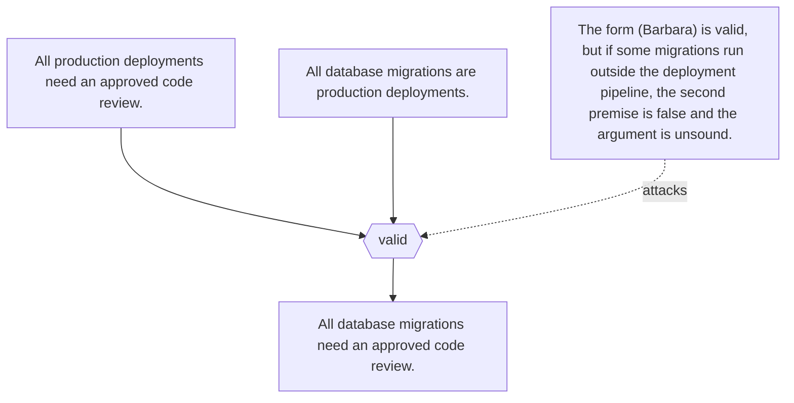
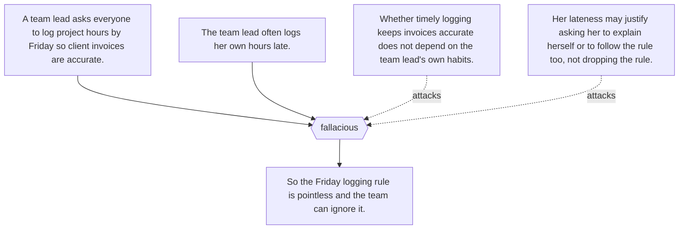
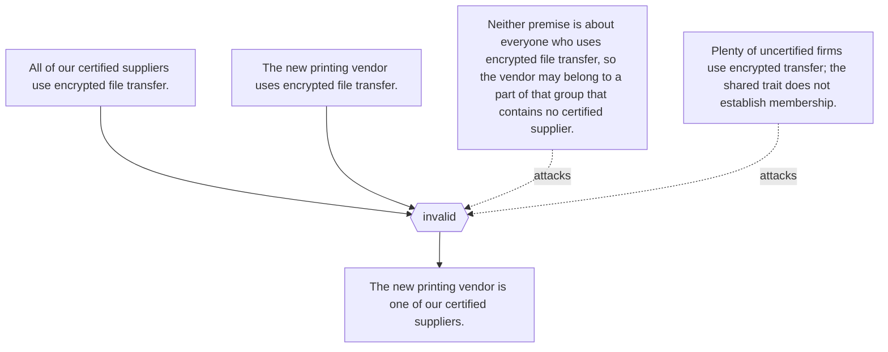

# Argument maps

Worked examples from each article's `argumentMap`, exported to RDF as AIF I-nodes (claims), RA-nodes (inferences) and CA-nodes (conflicts). Generated by `scripts/kg.py build`.

## Affirming the consequent (`ct:affirming-the-consequent`)

## Base-rate neglect (`ct:base-rate-neglect`)

## Deductive reasoning (`ct:deductive-reasoning`)

## Illicit major (`ct:illicit-major`)

## Modus ponens (`ct:modus-ponens`)

## Modus tollens (`ct:modus-tollens`)

## Straw man fallacy (`ct:straw-man-fallacy`)

## Syllogism (`ct:syllogism`)

## Tu quoque (`ct:tu-quoque`)

## Undistributed middle (`ct:undistributed-middle`)

